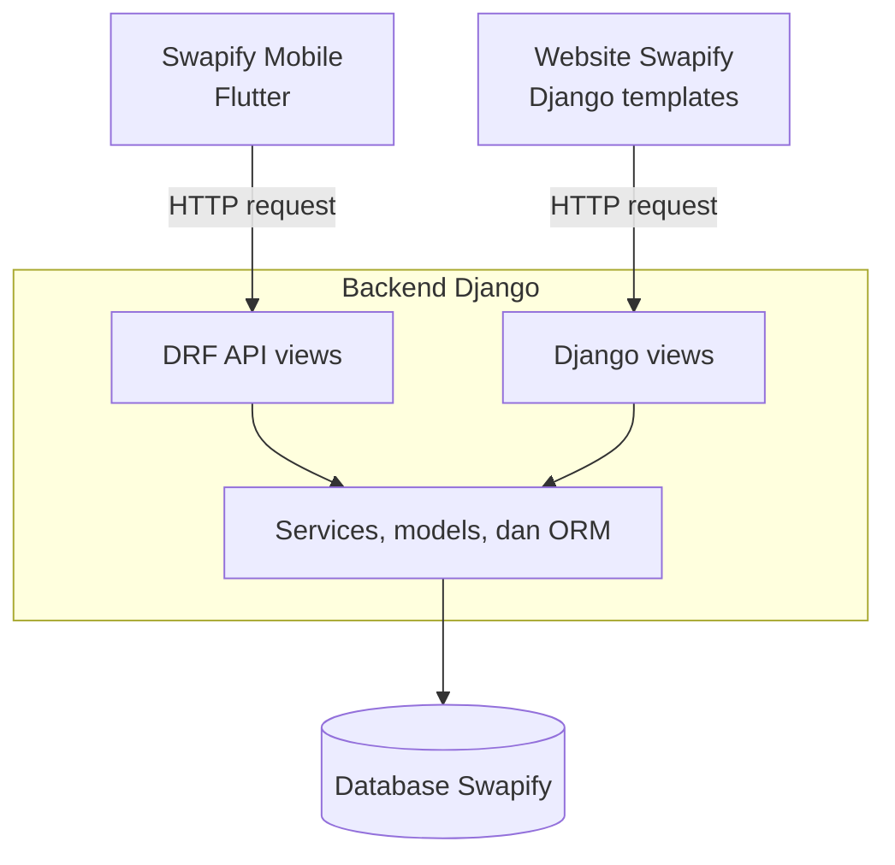

<div align="center">

# Swapify Mobile

#### Swap Smartly, Wear Happily

<p>
  
  
  
</p>

**F12 - PBP F**

</div>

---

## Description

**Swapify Mobile** adalah aplikasi mobile untuk platform pertukaran pakaian bekas layak pakai. Aplikasi ini dirancang agar pengguna dapat menemukan pakaian, mengajukan pertukaran, berkomunikasi, dan menyelesaikan transaksi melalui perangkat mobile.

Dengan konsep *slow fashion* dan *reuse*, Swapify bertujuan memperpanjang siklus penggunaan pakaian serta mendukung gaya hidup yang lebih berkelanjutan.

Aplikasi mobile dibangun menggunakan **Flutter**. Data dan logika bisnis disediakan oleh backend Django melalui **Django REST Framework (DRF)** yang dikelola di repositori website Swapify.

## Group Members

<table width="100%">
  <thead>
    <tr>
      <th width="120">Profile</th>
      <th width="420">Nama</th>
      <th width="180">NPM</th>
      <th width="420">Module</th>
    </tr>
  </thead>
  <tbody>
    <tr>
      <td align="center">
        <a href="https://github.com/leficullen">
          
        </a>
      </td>
      <td><strong>Muh. Alfi Rizqy</strong></td>
      <td>2506550721</td>
      <td>Profile &amp; Location<br/>Review &amp; Rating</td>
    </tr>
    <tr>
      <td align="center">
        <a href="https://github.com/rahelaruan91">
          
        </a>
      </td>
      <td><strong>Rahel Meilinda Aruan</strong></td>
      <td>2506598513</td>
      <td>Chat</td>
    </tr>
    <tr>
      <td align="center">
        <a href="https://github.com/popolkuproi">
          
        </a>
      </td>
      <td><strong>Naufal Alvaro Habibullah</strong></td>
      <td>2506657144</td>
      <td>Clothing Catalog</td>
    </tr>
    <tr>
      <td align="center">
        <a href="https://github.com/muhammaddawood-ui">
          
        </a>
      </td>
      <td><strong>Muhammad Dawood Alfathiin</strong></td>
      <td>2506610456</td>
      <td>Swap Request</td>
    </tr>
    <tr>
      <td align="center">
        <a href="https://github.com/mwf-yesido">
          
        </a>
      </td>
      <td><strong>Muh. Wildan Firdaus</strong></td>
      <td>2506595985</td>
      <td>Transaction</td>
    </tr>
  </tbody>
</table>

## Main Features

Fitur berikut merupakan **cakupan yang direncanakan** untuk Swapify Mobile:

- **Account & Profile:** Registrasi, login, onboarding, serta pengelolaan profil, preferensi gaya, foto, dan lokasi.
- **Clothing Catalog:** Menelusuri pakaian yang tersedia dan melihat detail listing.
- **Personal Wardrobe:** Mengelola pakaian yang ingin ditukarkan.
- **Swap Requests:** Mengajukan dan mengelola permintaan pertukaran.
- **Transaction:** Mengatur proses pertukaran melalui meetup atau pengiriman serta memantau status transaksi.
- **Chat:** Berkomunikasi dengan pengguna lain terkait pertukaran.
- **Review & Rating:** Memberikan dan melihat ulasan setelah transaksi selesai.

## User Flow

Alur berikut menggambarkan pengalaman pengguna yang direncanakan:

1. Pengguna mendaftar atau masuk ke akun Swapify.
2. Pengguna melengkapi profil, preferensi gaya, dan lokasi.
3. Pengguna menambahkan pakaian ke wardrobe.
4. Pengguna menelusuri katalog dan mengajukan permintaan swap.
5. Pemilik pakaian menerima atau menolak permintaan pertukaran.
6. Setelah swap disetujui, kedua pengguna berkomunikasi dan mengatur transaksi.
7. Kedua pengguna menyelesaikan pertukaran dan mengonfirmasi penerimaan.
8. Pengguna dapat memberikan review dan rating setelah transaksi selesai.

## Modules Details

### 1. Profile & Location

**PIC:** Muh. Alfi Rizqy  
**Halaman:** Profile

Modul ini direncanakan untuk menangani akun dan profil pengguna:

- Registrasi, login, logout, dan onboarding.
- Pengaturan nama tampilan, bio, foto profil, dan preferensi gaya.
- Pengelolaan lokasi pengguna.
- Tampilan profil pribadi dan profil pengguna lain.

### 2. Clothing Catalog

**PIC:** Naufal Alvaro Habibullah  
**Halaman:** Catalog

Modul ini direncanakan untuk membantu pengguna menemukan dan mengelola pakaian:

- Menampilkan daftar dan detail pakaian.
- Menambahkan, mengubah, dan menghapus listing milik pengguna.
- Menyediakan pencarian dan filter katalog.
- Menampilkan wardrobe pribadi.

### 3. Swap Request

**PIC:** Muhammad Dawood Alfathiin  
**Halaman:** Swaps

Modul ini direncanakan untuk mengelola permintaan pertukaran:

- Membuat permintaan swap dengan menawarkan pakaian.
- Melihat permintaan masuk dan keluar.
- Menerima, menolak, atau membatalkan permintaan sesuai peran pengguna.

### 4. Transaction

**PIC:** Muh. Wildan Firdaus  
**Halaman:** Activity / Transactions

Modul ini direncanakan untuk mengelola pelaksanaan pertukaran:

- Melihat status dan detail transaksi.
- Mengatur metode meetup atau pengiriman.
- Mengisi informasi yang diperlukan untuk pertukaran.
- Mengonfirmasi penerimaan barang dan penyelesaian transaksi.

### 5. Chat

**PIC:** Rahel Meilinda Aruan  
**Halaman:** Chat

Modul ini direncanakan untuk menyediakan komunikasi antarpengguna:

- Menampilkan daftar ruang chat.
- Membaca riwayat percakapan.
- Mengirim pesan kepada pengguna lain dalam proses pertukaran.

### 6. Review & Rating

**PIC:** Muh. Alfi Rizqy  
**Halaman:** Reviews, dapat diakses melalui Profile

Modul ini direncanakan untuk mengelola ulasan pengguna:

- Memberikan rating dan komentar setelah transaksi selesai.
- Melihat ulasan yang diterima pengguna.
- Menampilkan informasi rating pada profil.

## Integrasi Data Mobile dan Website

Swapify Mobile dan website Swapify menggunakan backend Django yang sama. Website merupakan aplikasi Proyek Tengah Semester yang berjalan pada PWS, sedangkan aplikasi mobile dikembangkan menggunakan Flutter di repositori terpisah.

Django REST Framework menyediakan *web service* yang memungkinkan aplikasi Flutter berkomunikasi dengan backend melalui HTTP. Aplikasi mobile dan website dapat menggunakan data serta aturan bisnis yang sama ketika keduanya terhubung ke deployment dan database yang sama.

### Alur integrasi



1. Pengguna melakukan interaksi pada aplikasi Flutter, misalnya membuka katalog atau mengajukan swap.
2. Flutter mengirim HTTP request ke endpoint DRF pada backend Django.
3. Backend melakukan autentikasi, memeriksa hak akses, dan memvalidasi data.
4. Backend menjalankan aturan bisnis serta membaca atau mengubah data melalui Django ORM.
5. DRF mengirimkan respons dalam bentuk JSON beserta HTTP status code.
6. Flutter membaca respons dan memperbarui tampilan.

Website menggunakan Django views dan template untuk menampilkan halaman. Ketika website dan mobile terhubung ke database yang sama, perubahan yang berhasil disimpan melalui salah satu aplikasi dapat terlihat pada aplikasi lainnya setelah data dimuat ulang.

### Autentikasi

Fondasi API saat ini menggunakan **Django session**. Alur integrasi yang direncanakan untuk Flutter adalah:

1. Flutter meminta CSRF cookie melalui `GET /api/v1/auth/csrf/`.
2. Flutter mengirim kredensial ke endpoint login bersama cookie dan token CSRF.
3. Setelah login berhasil, client menyimpan cookie session yang dikirim server.
4. Pada request berikutnya, Flutter mengirim cookie session. Request yang mengubah data juga menyertakan token CSRF terbaru melalui header `X-CSRFToken`.
5. Flutter membaca respons backend untuk menangani keberhasilan atau error.

Integrasi session, cookie, dan CSRF pada sisi Flutter masih dalam pengembangan.

## Daftar Endpoint API


### Authentication dan Profile & Location

<table width="100%">
  <thead>
    <tr><th width="15%">Method</th><th width="50%">Endpoint</th><th width="35%">Keterangan</th></tr>
  </thead>
  <tbody>
    <tr><td><code>GET</code></td><td><code>/api/v1/auth/csrf/</code></td><td>Mendapatkan CSRF cookie.</td></tr>
    <tr><td><code>POST</code></td><td><code>/api/v1/auth/register/</code></td><td>Mendaftarkan pengguna baru.</td></tr>
    <tr><td><code>POST</code></td><td><code>/api/v1/auth/login/</code></td><td>Login dan membuat session pengguna.</td></tr>
    <tr><td><code>POST</code></td><td><code>/api/v1/auth/logout/</code></td><td>Mengakhiri session pengguna.</td></tr>
    <tr><td><code>GET</code></td><td><code>/api/v1/profile/me/</code></td><td>Melihat profil pengguna yang sedang login.</td></tr>
    <tr><td><code>PATCH</code></td><td><code>/api/v1/profile/me/</code></td><td>Mengubah informasi profil dan preferensi pengguna.</td></tr>
    <tr><td><code>POST</code></td><td><code>/api/v1/profile/me/photo/</code></td><td>Mengunggah foto profil.</td></tr>
    <tr><td><code>PUT</code></td><td><code>/api/v1/profile/me/location/</code></td><td>Menyimpan lokasi profil.</td></tr>
    <tr><td><code>POST</code></td><td><code>/api/v1/locations/resolve/</code></td><td>Mengubah koordinat menjadi informasi area.</td></tr>
    <tr><td><code>POST</code></td><td><code>/api/v1/profile/me/onboarding/{step}/</code></td><td>Menyimpan data onboarding pada tahap tertentu.</td></tr>
    <tr><td><code>GET</code></td><td><code>/api/v1/profiles/{username}/</code></td><td>Melihat profil publik pengguna.</td></tr>
  </tbody>
</table>

### Clothing Catalog

<table width="100%">
  <thead>
    <tr><th width="15%">Method</th><th width="50%">Endpoint</th><th width="35%">Keterangan</th></tr>
  </thead>
  <tbody>
    <tr><td><code>GET</code></td><td><code>/api/v1/clothing/</code></td><td>Melihat daftar pakaian.</td></tr>
    <tr><td><code>POST</code></td><td><code>/api/v1/clothing/</code></td><td>Menambahkan listing pakaian.</td></tr>
    <tr><td><code>GET</code></td><td><code>/api/v1/clothing/me/</code></td><td>Melihat pakaian milik pengguna yang sedang login.</td></tr>
    <tr><td><code>GET</code></td><td><code>/api/v1/clothing/{uuid}/</code></td><td>Melihat detail pakaian.</td></tr>
    <tr><td><code>PATCH</code></td><td><code>/api/v1/clothing/{uuid}/</code></td><td>Mengubah listing milik pengguna.</td></tr>
    <tr><td><code>DELETE</code></td><td><code>/api/v1/clothing/{uuid}/</code></td><td>Menghapus listing milik pengguna.</td></tr>
  </tbody>
</table>

### Swap Request

<table width="100%">
  <thead>
    <tr><th width="15%">Method</th><th width="50%">Endpoint</th><th width="35%">Keterangan</th></tr>
  </thead>
  <tbody>
    <tr><td><code>GET</code></td><td><code>/api/v1/swap-requests/</code></td><td>Melihat daftar permintaan swap.</td></tr>
    <tr><td><code>POST</code></td><td><code>/api/v1/swap-requests/</code></td><td>Membuat permintaan swap.</td></tr>
    <tr><td><code>GET</code></td><td><code>/api/v1/swap-requests/{id}/</code></td><td>Melihat detail permintaan swap.</td></tr>
    <tr><td><code>POST</code></td><td><code>/api/v1/swap-requests/{id}/accept/</code></td><td>Menerima permintaan swap.</td></tr>
    <tr><td><code>POST</code></td><td><code>/api/v1/swap-requests/{id}/reject/</code></td><td>Menolak permintaan swap.</td></tr>
    <tr><td><code>POST</code></td><td><code>/api/v1/swap-requests/{id}/cancel/</code></td><td>Membatalkan permintaan swap.</td></tr>
  </tbody>
</table>

### Transaction


<table width="100%">
  <thead>
    <tr><th width="15%">Method</th><th width="50%">Path modul</th><th width="35%">Keterangan</th></tr>
  </thead>
  <tbody>
    <tr><td><code>GET</code></td><td><code>{uuid}/</code></td><td>Melihat detail transaksi.</td></tr>
    <tr><td><code>PUT</code>, <code>PATCH</code></td><td><code>{uuid}/update/</code></td><td>Mengubah detail transaksi.</td></tr>
    <tr><td><code>POST</code></td><td><code>{uuid}/start/</code></td><td>Menyatakan kesiapan atau memulai transaksi.</td></tr>
    <tr><td><code>POST</code></td><td><code>{uuid}/cancel/</code></td><td>Membatalkan status kesiapan pengguna.</td></tr>
    <tr><td><code>POST</code></td><td><code>{uuid}/validate-resi/</code></td><td>Memvalidasi resi pihak lain.</td></tr>
    <tr><td><code>POST</code></td><td><code>{uuid}/unvalidate-resi/</code></td><td>Membatalkan validasi resi.</td></tr>
    <tr><td><code>POST</code></td><td><code>{uuid}/confirm-received/</code></td><td>Mengonfirmasi penerimaan barang.</td></tr>
  </tbody>
</table>

### Chat

<table width="100%">
  <thead>
    <tr><th width="15%">Method</th><th width="50%">Endpoint</th><th width="35%">Keterangan</th></tr>
  </thead>
  <tbody>
    <tr><td><code>GET</code></td><td><code>/chat/rooms/</code></td><td>Melihat daftar ruang chat pengguna.</td></tr>
    <tr><td><code>GET</code></td><td><code>/chat/rooms/{id}/messages/</code></td><td>Melihat pesan pada ruang chat.</td></tr>
    <tr><td><code>POST</code></td><td><code>/chat/rooms/{id}/messages/</code></td><td>Mengirim pesan pada ruang chat.</td></tr>
    <tr><td><code>POST</code></td><td><code>/chat/rooms/{id}/read/</code></td><td>Menandai pesan sebagai telah dibaca.</td></tr>
  </tbody>
</table>

### Review & Rating

<table width="100%">
  <thead>
    <tr><th width="15%">Method</th><th width="50%">Endpoint</th><th width="35%">Keterangan</th></tr>
  </thead>
  <tbody>
    <tr><td><code>GET</code></td><td><code>/api/v1/profiles/{username}/reviews/</code></td><td>Melihat review yang diterima pengguna.</td></tr>
    <tr><td><code>GET</code></td><td><code>/api/v1/transactions/{uuid}/reviews/</code></td><td>Melihat review pada transaksi sebagai peserta.</td></tr>
    <tr><td><code>POST</code></td><td><code>/api/v1/transactions/{uuid}/reviews/</code></td><td>Membuat review untuk transaksi yang sudah selesai.</td></tr>
  </tbody>
</table>

## Project Structure

```text
lib/
├── core/
│   ├── navigation/      
│   ├── theme/            
│   └── widgets/          
│
├── features/
│   ├── catalog/
│   │   └── screens/
│   ├── chat/
│   │   └── screens/
│   ├── profile/
│   │   └── screens/
│   ├── reviews/
│   │   └── screens/
│   ├── swaps/
│   │   └── screens/
│   └── transactions/
│       └── screens/
│
└── main.dart
```

Kode yang khusus untuk satu fitur ditempatkan di dalam folder fitur terkait. Kode yang digunakan bersama oleh beberapa fitur ditempatkan di dalam `core/`.

## Local Development

### 1. Prasyarat

Pastikan perangkat sudah memiliki:

- Flutter SDK yang kompatibel dengan proyek.
- Dart SDK yang disertakan bersama Flutter.
- Android Studio, Xcode, atau perangkat lain yang didukung untuk menjalankan aplikasi.

Proyek ini menggunakan constraint Dart SDK `^3.13.7`. Periksa instalasi Flutter dengan:

```bash
flutter doctor
```

### 2. Clone repositori

```bash
git clone https://github.com/F12-PBP/swapify-mobile.git
cd swapify-mobile
```

### 3. Instal dependency

```bash
flutter pub get
```

### 4. Jalankan aplikasi

Pastikan emulator, simulator, atau perangkat fisik sudah tersedia, lalu jalankan:

```bash
flutter run
```

Untuk melihat daftar perangkat yang terdeteksi:

```bash
flutter devices
```

### 5. Jalankan pemeriksaan

```bash
flutter analyze
flutter test
```

> Integrasi backend dan konfigurasi alamat API akan didokumentasikan setelah implementasi client tersedia.

## Deployment & Design

| Resource | Tautan |
| :--- | :--- |
| Repositori mobile | https://github.com/F12-PBP/swapify-mobile |
| Repositori backend dan website | https://github.com/F12-PBP/swapify |
| Website Swapify | https://muh-alfi-swapify.pws.cs.ui.ac.id/ |
| Figma website | https://www.figma.com/design/zbqXXY2vi6KXI1w4Agn4DO/Swapify?node-id=250-510&t=j8oUGtqQzmIFYrRN-1 |
| Figma mobile | Coming Soon |
| APK | Coming Soon |

---

<div align="center">

### Swapify Mobile

**Swap Smartly, Wear Happily**

**F12 - PBP F**

Alfi · Rahel · Alvaro · Dawood · Wildan

</div>
